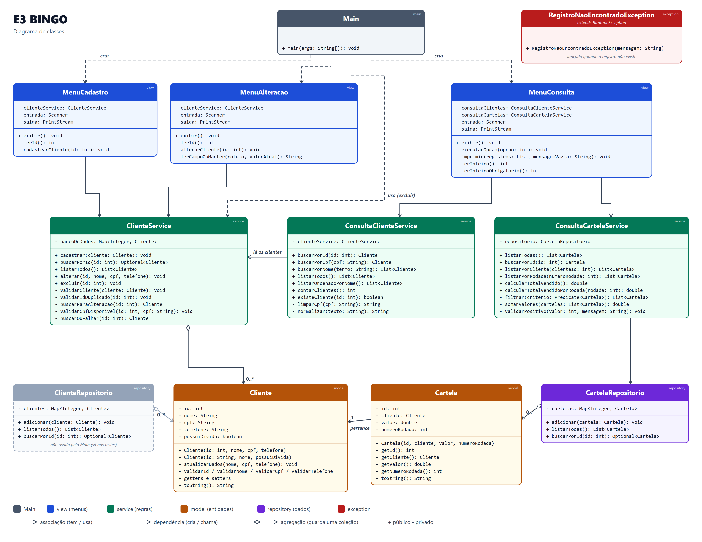

# E3 - BINGO

Sistema de gestao de bingo desenvolvido em Java para o Trabalho A3 da disciplina Gestao e Qualidade de Software.

O sistema apoia a gestao de um jogo de bingo: clientes (cadastrar, consultar, alterar e excluir), venda de cartelas, rodadas do bingo e financeiro (venda de cartelas x gastos com premiacoes).

## Aviso sobre a conta do GitHub

Este repositorio foi criado em uma conta diferente da usada nas atividades anteriores, porque o limite de uso do Codespaces da conta anterior foi atingido.

## Integrantes

| Nome | RA | GitHub |
|------|----|--------|
| Ana Beatriz Silva Costa | 326132109 | @beatrizc-s |
| Gabriel de Souza Ribeiro | 32514596 | @GabrielSouaz |
| Carlos Gabriel Claudino de Souza | 325131028 | @9890858Cg |
| Lara Cristyna Rodrigues Lopes Silva | 325131743 | @LaraCristy |
| Breno Henrique Barbosa Correia | 32517400 | @Brenoh1810 |
| Bento Ramalho Botelho | 325119554 | @CelestialB80-jpg |

## Tecnologias

- Java 17
- Maven
- JUnit 5 (testes unitarios)
- Git e GitHub (versionamento)

## Estrutura do projeto

```
E3---BINGO
|-- pom.xml
|-- README.md
|-- src
    |-- main/java/br/com/bingo
    |   |-- Main.java
    |   |-- model
    |   |-- service
    |-- test/java/br/com/bingo
```

## Diagrama de classes



Tambem disponivel em [SVG](docs/diagrama_classes.svg), que nao perde qualidade com zoom.

## Apresentacao

Os slides da apresentacao do trabalho estao em [docs/apresentacao_E3_BINGO.pptx](docs/apresentacao_E3_BINGO.pptx).

## Como executar

Compilar e rodar os testes:

```
mvn test
```

Executar o sistema:

```
mvn compile exec:java -Dexec.mainClass="br.com.bingo.Main"
```

Ou compilando e executando direto:

```
mvn compile
java -cp target/classes br.com.bingo.Main
```

### Sem Maven (so com o Java)

Se o computador nao tiver Maven, basta ter o Java (versao 17 ou superior) instalado. Dentro da pasta do projeto:

```
javac -encoding UTF-8 -d out -sourcepath src/main/java src/main/java/br/com/bingo/Main.java
java -cp out br.com.bingo.Main
```

O primeiro comando compila a classe `Main` e, a partir dela, todas as classes que ela usa (o `-sourcepath` diz ao `javac` onde procurar). Funciona em qualquer terminal: PowerShell, Prompt de Comando, Git Bash, Linux ou macOS.

Para conferir se o Java esta instalado: `java -version`.

Os testes JUnit precisam das bibliotecas do JUnit, entao para roda-los use o Maven (`mvn test`) ou uma IDE (no IntelliJ ou no VS Code: clique com o botao direito em `src/test/java` e escolha rodar todos os testes). Eles tambem rodam automaticamente no GitHub Actions a cada Pull Request.

## Funcionalidade de Consulta

Desenvolvida na branch `feature/consulta`, seguindo o ciclo RED, GREEN, REFACTOR.

Classes:

- `model/Cliente` e `model/Cartela`: entidades com atributos privados e validacao no construtor
- `repository/ClienteRepositorio` e `repository/CartelaRepositorio`: armazenamento em memoria
- `service/ConsultaClienteService`: le os clientes do `ClienteService` (o mesmo usado no cadastro, alteracao e exclusao); busca por id, CPF (com ou sem pontuacao) e nome (ignora maiusculas e acentos), listagem por id e por nome, contagem e verificacao de existencia
- `service/ConsultaCartelaService`: busca por id, listagem geral, por cliente e por rodada, total vendido geral e por rodada
- `exception/RegistroNaoEncontradoException`: lancada quando o registro consultado nao existe
- `view/MenuConsulta`: submenu de consulta no console (opcao 2 do menu principal)

Testes: `ClienteTest`, `CartelaTest`, `ClienteRepositorioTest`, `CartelaRepositorioTest`, `ConsultaClienteServiceTest`, `ConsultaCartelaServiceTest` e `MenuConsultaTest` (caso normal, valor limite e caso de erro para cada metodo).

## Funcionalidade de Alteracao

Desenvolvida na branch `feature/alteracao`, seguindo o ciclo RED, GREEN, REFACTOR.

Classes e metodos:

- `model/Cliente.atualizarDados(nome, cpf, telefone)`: valida nome (nao vazio), CPF (11 digitos) e telefone (opcional, 10 ou 11 digitos) e so entao atribui, de modo que um erro nunca deixa o cliente alterado pela metade. O id nunca muda
- `service/ClienteService.alterar(id, nome, cpf, telefone)`: lanca `IllegalArgumentException` para id menor ou igual a zero e para CPF ja usado por outro cliente, e `RegistroNaoEncontradoException` quando o cliente nao existe
- `view/MenuAlteracao`: submenu de alteracao no console (opcao 3 do menu principal); Enter em branco mantem o valor atual

Testes: `ClienteAlteracaoTest`, `ClienteServiceAlteracaoTest` e `MenuAlteracaoTest` (caso normal, valor limite e caso de erro para cada metodo).

## Branches

- `main`: versao estavel, sem push direto (somente via Pull Request)
- `develop`: integracao das funcionalidades
- `feature/cadastro`: Pessoa 2
- `feature/consulta`: Pessoa 3
- `feature/alteracao`: Pessoa 4
- `feature/exclusao`: Pessoa 5

Fluxo: cada integrante trabalha na sua branch `feature/*`, faz commits proprios e abre Pull Request para `develop`.

## Divisao de tarefas

| Pessoa | Responsabilidade |
|--------|------------------|
| 1 | Organizacao e estrutura (repositorio, branches, estrutura Java, Main, README) |
| 2 | Cadastro |
| 3 | Consulta |
| 4 | Alteracao |
| 5 | Exclusao |
| 6 | Integracao e qualidade |

Todos os integrantes devem ter commits proprios e seguir o ciclo RED, GREEN, REFACTOR nos testes.
